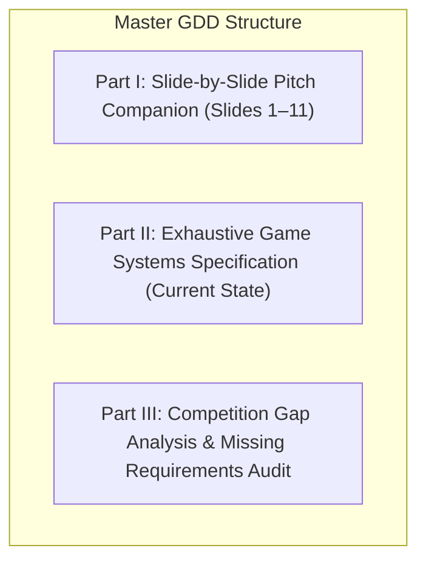
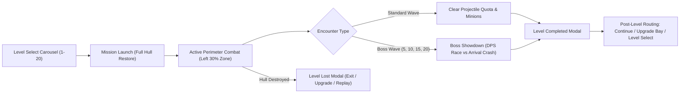
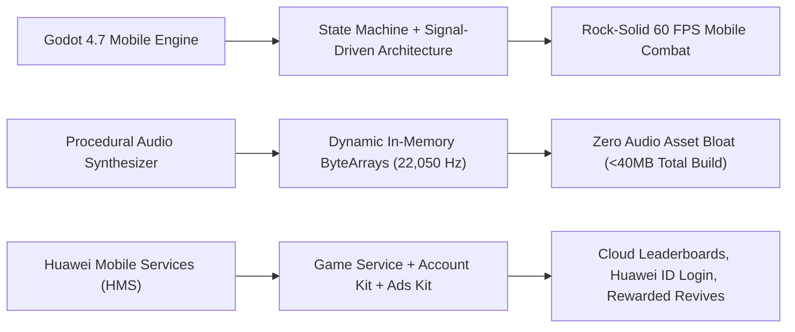
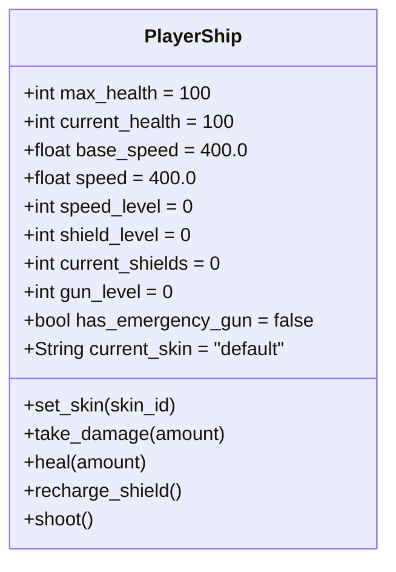
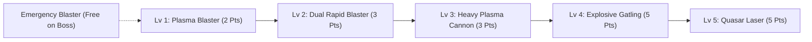
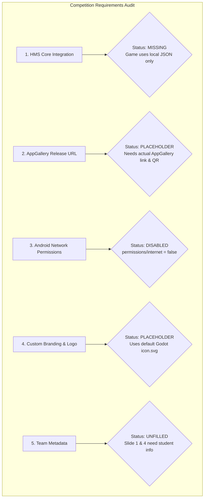

# SPACE SHOOTER 2D: VOID PROTOCOL
## MASTER GAME DESIGN DOCUMENT (GDD) — COMPETITION EDITION
**Event:** 5th UMPSA × HUAWEI GameCenter Mobile App Competition 2026 (25 November 2026)  
**Organizers & Partners:** UMPSA, HUAWEI GameCenter, MDEC, TalentCorp, CYBERVIEW, Premier Digital Tech Institution (MD)  
**Document Version:** 3.0 (Current Engine State & Competition Presentation Locked)  
**Target Platform:** Mobile (HUAWEI AppGallery / GameCenter & Android) + Desktop  
**Engine:** Godot Engine 4.7 (Mobile Renderer, Jolt Physics 2D)  
**Native Viewport:** 1920 × 1080 (Aspect: Expand, Stretch: Canvas Items)  
**Package Identifier:** `com.gamespew.starshooterspew`  

---

# EXECUTIVE OVERVIEW

This Master Game Design Document synthesizes the **exact current state of the game**—including the recently implemented Level Select Carousel, Hangar Skin Customization, Pause System, Post-Level Decision Modals, and Rebalanced Single-Claim Economy—while serving as the **authoritative reference manual for your teammates to build the official 12-slide competition presentation**.

---

# PART I: SLIDE-BY-SLIDE COMPETITION COMPANION (SLIDES 1–11)

*Teammates can copy and adapt this content directly into the official competition PowerPoint template.*

---

### Slide 1: Title & App Identity
* **Mobile App Name:** Space Shooter 2D: Void Protocol *(or Space Shooter 2D)*
* **Project Name:** New-Game-Auto (Space Shooter 2D)
* **Competition:** 5th UMPSA × HUAWEI GameCenter Mobile App Competition 2026 (25 November 2026)
* **Organizers:** UMPSA, HUAWEI GameCenter, MDEC, TalentCorp, CYBERVIEW, MD
* **Team Members:** `[Participant 1]`, `[Participant 2]`, `[Participant 3]`
* **Contact:** Email & Phone
* **App Assets Box:**
  * **App Logo:** High-contrast sci-fi starship with glowing cyan energy reticle.
  * **App QR Code:** Direct link to game package on HUAWEI GameCenter / AppGallery *(or placeholder with note: "Published in HUAWEI GameCenter / Submission Pending Review")*.

---

### Slide 2: Game Overview Table

| Field | Official Slide Content |
| :--- | :--- |
| **Mobile Game Name** | **Space Shooter 2D: Void Protocol** |
| **Developer Name** | `[Your Team / Studio Name]` |
| **Game Genre** | 2D Arcade Space Shoot 'Em Up (Shmup) / Tactical Roguelite Action |
| **Keywords** | Space Shooter, Shmup, Arcade, Bullet Interception, Level Progression, Boss Rush, Hangar Skins, Huawei GameCenter |
| **URL in HUAWEI GameCenter** | `https://appgallery.cloud.huawei.com/#/app/C112399131` *(Pending publication / replace with actual App ID)* |
| **Mobile Game Description** | A futuristic Malay-themed space shoot 'em up (*Hikayat Angkasa*) that modernizes classic arcade combat with active projectile interception and rich cultural sci-fi progression. As the Ancient Coalition—led by the phantom dreadnought *Kapal Minangkabau* and autonomous *Waurior* titans—threatens the Malay Realm, players pilot four legendary Pendekar starfighters (*Hang Tuah, Hang Jebat, Hang Kasturi, Hang Lekir*). Defend the realm across 20 escalating tactical missions, perform orbital kinetic silat deflections, customize hulls in the Hangar, optimize weapons in the Upgrade Bay, and survive thrilling boss showdowns at the sacred astral peaks. |

---

### Slide 3: Table of Contents
1. **Team Introduction**
2. **Game Concept & Objectives**
3. **Gameplay & Key Features**
4. **Game Innovation**
5. **Technical Development & HMS Kit Integration**
6. **UI/UX, Visual & Audio Design**
7. **Market Potential & Future Development**
8. **Game Summary**

---

### Slide 4: 1. Team Introduction

| Team Member | Role | Experience & Key Contribution to Game Development |
| :--- | :--- | :--- |
| **`[Name 1]`** | Lead Game Designer & Gameplay Programmer | Designed the core 20-level mission structure, projectile interception math, boss enrage states, and single-claim economy balance. |
| **`[Name 2]`** | Mobile UI/UX & Technical Artist | Engineered the dual-touch mobile controls (Virtual Joystick, hold-to-shoot reticle), slideable Level Select carousel, Hangar skins, and procedural starfield. |
| **`[Name 3]`** | Systems Architect & Platform Engineer | Built the state machine lifecycle, in-memory cached SaveManager, procedural real-time 8-bit audio synthesizer, and HMS Core integration architecture. |

---

### Slide 5: 2. Game Concept & Objectives
* **Background & Inspiration:** Modernizing legendary arcade shooters (*Raiden*, *Galaxian*, *Ikaruga*) for modern mobile touchscreens with a distinct futuristic Malay sci-fi universe (*Hikayat Angkasa*).
* **Core Concept & Theme:** Interstellar defense of the Celestial Malay Realm (*Alam Melayu*) against the Ancient Reclaimer Coalition—spearheaded by the legendary phantom dreadnought *Kapal Minangkabau* and autonomous sky-kite titans (*Waurior*). High Command mobilizes **Projek Empat Pendekar**: four experimental starfighters named after legendary Malay warriors—**Hang Tuah, Hang Jebat, Hang Kasturi, and Hang Lekir**.
* **Cultural-Gameplay Innovation (Silat Tangkis Angkasa):** Active projectile interception translates the parrying philosophy of traditional *Pencak Silat* into space combat, allowing players to actively neutralize incoming ordnance with offensive firepower.
* **Purpose of the Game:** Provide an instantly playable, skill-first mobile arcade experience celebrating Malaysian cultural heritage, free from predatory pay-to-win mechanics.
* **Main Objectives:**
  1. Complete a **20-mission galactic campaign** across 4 cultural sci-fi sectors (KLCC, A Famosa, Rumah Minangkabau, Gunung Ledang).
  2. Master **Active Kinetic Interception (Silat Tangkis Angkasa)** by deflecting enemy projectiles.
  3. Defeat **4 Titan Boss encounters** (*Waurior*, *Kapal Minangkabau*, *Twin Waurior*, *Ancient Coalition*) before they breach the defensive perimeter ($X \le 340\text{ px}$).
  4. Collect mission completion crowns and equip legendary Pendekar starfighter hulls in the Hangar.
* **Intended Player Experience:** High-adrenaline arcade flow where split-second dodges, cultural resonance, and proactive bullet cancellation create deeply rewarding mastery.

---

### Slide 6: 3. Gameplay & Key Features

* **Key Gameplay Mechanics:**
  * **Defensive Spatial Perimeter:** Flight restricted to the left 30% of the screen ($X \in [64, 576]$ px), creating intense spatial awareness and dodging requirements.
  * **Active Kinetic Interception:** Every player projectile physically collides with and neutralizes incoming enemy ordnance, converting offense into defense ($+10\text{ score}$).
  * **Rebalanced Single-Claim Economy:** Each level awards $+1$ Upgrade Point ($+3$ on Bosses) **on first-time completion only**, preventing infinite point grinding and rewarding true campaign progression.
  * **Boss Arrival Crash Timer:** Bosses advance toward the player line. Crossing $X \le 340\text{ px}$ inflicts an **instant-kill $100\text{ damage}$ crash**, demanding aggressive, sustained firepower.
  * **Lethal Charger Roach Trait:** Charger Roaches charge at $620\text{ px/s}$ and trigger an **instant kill ($100\text{ damage}$)** if the player is caught unshielded!
  * **Tactical Upgrade Bay:** Upgrade Thrusters, Kinetic Shields, and 5 weapon tiers between missions. Full HP is automatically restored at the start of every mission.

---

### Slide 7: 4. Game Innovation

#### Innovation Formula: *Existing Approach $\to$ Our Approach $\to$ What Changed*

```mermaid
flowchart TD
    subgraph I1["1. Active Bullet Interception"]
        E1["Existing: Enemy bullets are lethal, untouchable walls"] --> A1["Our Approach: Kinetic Collision Interception"]
        A1 --> C1["What Changed: Defense becomes offense; shooting cancels enemy fire"]
    end
    subgraph I2["2. Physical Boss DPS Timer"]
        E2["Existing: Static bullet sponges with arbitrary countdowns"] --> A2["Our Approach: Arrival Crash Spatial Encroachment"]
        A2 --> C2["What Changed: Real physical tension as Titans advance toward X <= 340px"]
    end
    subgraph I3["3. Mobile Touch Ergonomics"]
        E3["Existing: Finger-dragging over the ship blocks sightlines"] --> A3["Our Approach: Separated Left Joystick + Right Reticle"]
        A3 --> C3["What Changed: 100% battlefield visibility; calibrated deadzone and hold-to-shoot"]
    end
    subgraph I4["4. Campaign Progression & Fairness"]
        E4["Existing: Endless grind or predatory stamina energy gates"] --> A4["Our Approach: 20-Level Carousel + Single-Claim Rewards"]
        A4 --> C4["What Changed: Transparent skill progression with Hangar skin unlocks"]
    end
```

---

### Slide 8: 5. Technical Development & HMS Kit Integration

#### Technical Framework: *Technology $\to$ Implementation $\to$ Result*

* **Game Engine & Core Tech:** Godot Engine 4.7 (Mobile Renderer, Jolt Physics 2D, Canvas Item rendering, Typed GDScript 2.0).
* **Technical Architecture Highlights:**
  * Decoupled signal-driven HUD managing Level Select Carousel, Pause screen, and Post-Level routing modals.
  * In-memory cached [`SaveManager`](file:///Users/idil/GodotProjectFile/new-game-auto/scripts/save_manager.gd) preventing redundant disk I/O and JSON float serialization artifacts.
  * Procedural multi-layer parallax starfield (130 distant twinkling stars, 70 mid-field streak stars, periodic shooting stars) rendered on Canvas Layer `-10`.
  * Real-time procedural byte-array audio synthesizer generating 8-bit WAV streams on the fly with zero external audio assets.
* **Huawei Mobile Services (HMS) Integration Architecture:**
  * **HMS Game Service:** Global Cloud Leaderboards (campaign completion score & deepest wave reached) and Cloud Achievements (*"Titan Slayer"*, *"Queen's Demise"*, *"Arsenal Master"*).
  * **HMS Account Kit:** Seamless, one-tap Huawei ID authentication for automatic cloud save synchronization across devices.
  * **HMS Ads Kit:** Rewarded Video ad option on the Level Lost screen granting an **"Emergency Reinforcement"** (1-time revive with 50% hull integrity).
  * **HMS Analytics Kit:** Tracking drop-off rates across all 20 levels to dynamically balance enemy speed and quota curves.

---

### Slide 9: 6. UI/UX, Visual & Audio Design
* **User Interface & Navigation:**
  * Slideable 5-column $\times$ 2-row Level Select carousel with touch drag, page navigation arrows, locked/unlocked visual badges, and crown completion stamps.
  * Top-center Pause Button during active gameplay with Exit, Replay, and Resume options.
  * Post-level decision routing: Level Completed modal (Exit, Upgrade, Continue) and Level Lost modal (Exit, Upgrade, Replay).
  * Mobile-optimized Upgrade Bay with oversized touch buttons ($320\times 66$ px and $460\times 68$ px).
* **Visual Identity & Color Semantics:**
  * *4-Sector Modular Background Engine:* 20 campaign levels partitioned into 4 distinct cultural sci-fi environments with infinite seamless horizontal repeating ($W_{\text{display}}$ wraparound math eliminating subpixel gaps), configurable Dictionary data model (`background_sectors`), and **session persistence** (`last_played_level` in `SaveManager` ensuring the Main Menu displays the last stage played even across game restarts):
    * **Sector 1 (Stages 1–5):** KLCC Sky Horizon (`KlccBackground.png`) — Iconic twin spires amidst celestial azure clouds ($40\text{ px/s}$).
    * **Sector 2 (Stages 6–10):** Kota A Famosa Fortress (`KotaAFamosaBackground.png`) — Historic stone bastion illuminated by cosmic flares ($55\text{ px/s}$).
    * **Sector 3 (Stages 11–15):** Rumah Minangkabau $\times$ Istana Awan (`RumahMinangKabauxIstanaAwanBackground.png`) — Traditional curved rooflines drifting in high-altitude cloud palaces ($70\text{ px/s}$).
    * **Sector 4 (Stages 16–20):** Lembah Keris $\times$ Gunung Ledang (`LembahKerisXGunungLedang.png`) — Mythical blade silhouettes over misty celestial peaks ($90\text{ px/s}$).
  * *Player Interceptor:* High-contrast cyan chassis with swappable Hangar skins and reactive engine flares.
  * *Kinetic Shield:* Translucent cyan energy sphere with impact-reactive pulse.
  * *Enemy Fire:* Color-coded projectile semantics (Orange = Direct, Neon Violet = Wavy, Amber = Accelerating, Crimson = Fast Dart, Electric Magenta = Predictive Zoning, Acid Green = Toxic Bile).
* **Procedural Sound Experience:**
  * Wave-start chimes ($330 \to 440\text{ Hz}$), major triad victory fanfares ($440 \to 554 \to 659\text{ Hz}$), punchy bass-drop cannon discharges, and high-frequency laser pitch sweeps.

---

### Slide 10: 7. Market Potential & Future Development

#### Market Formula: *Target Audience $\to$ Market Need $\to$ Our Game $\to$ Potential*

* **Target Audience:** Casual & mid-core mobile gamers (ages 16–35), arcade shmup veterans, and competitive leaderboard enthusiasts.
* **Market Opportunity:** Mobile app stores are saturated with gacha-heavy, auto-play shmups with cluttered screens and predatory microtransactions. There is immense appetite for a clean, skill-first, fair arcade experience.
* **Player Retention & Engagement:** 20 escalating campaign missions with completion crowns, swappable Hangar starship skins, and replayable boss encounters.
* **Ethical Monetization Strategy:**
  * Free-to-Play on HUAWEI AppGallery.
  * Non-intrusive HMS Rewarded Video Ads (e.g., 1 emergency revive per level attempt).
  * Optional cosmetic starship skins in the Hangar via HMS In-App Purchases (zero pay-to-win mechanics).
* **Scalable Roadmap:**
  * *Phase 1:* Finalize HMS Game Service cloud leaderboards and Huawei ID login.
  * *Phase 2:* Implement Endless "Chaos Protocol" survival mode with weekly leaderboard resets.
  * *Phase 3:* Multiplayer Co-op Titan Raids utilizing Huawei GameCenter real-time networking.

---

### Slide 11: 8. Game Summary & Final Takeaway
* **Core Concept:** A modern 2D space shooter combining classic arcade reflexes with roguelite progression and active bullet interception.
* **Key Innovation:** Active Kinetic Interception (canceling enemy bullets) paired with physical Boss Arrival Crash DPS timers.
* **Major Features:** 20-level mission carousel, swappable Hangar skins, 5 evolving weapon tiers, 5 distinct minion archetypes, and 4 multi-phase Titan Boss encounters.
* **Technical Strengths:** Lightweight Godot 4.7 mobile architecture, procedural starfield parallax, and procedural in-memory audio engine (<40MB total footprint).
* **Future Potential:** Scalable live-ops arcade title primed for HUAWEI GameCenter cloud competition, achievements, and global community leaderboards.
* **Final Takeaway:** **Space Shooter 2D: Void Protocol** transforms defense into offense, proving that classic arcade action and modern mobile ergonomics can deliver a thrilling, skill-first gaming experience.

---

# PART II: EXHAUSTIVE GAME SYSTEMS SPECIFICATION (CURRENT CODE STATE)

---

## 1. Player Ship Architecture & Attributes

### 1.1 Boundaries & Movement Physics
* **Defensive Spatial Perimeter:** Clamped strictly to the left 30% of the viewport:
  $$X_{\min} = 64.0\text{ px}, \quad X_{\max} = 0.30 \times \text{Viewport Width} \approx 576.0\text{ px}$$
  $$Y_{\min} = 64.0\text{ px}, \quad Y_{\max} = \text{Viewport Height} - 64.0 \approx 1016.0\text{ px}$$
* **Movement Vectors:** 4-way omnidirectional velocity (`move_up`, `move_down`, `move_left`, `move_right`) executed via `move_and_slide()` with zero slip upon input release.

### 1.2 Thruster Upgrades

| Level | Flight Speed | Speed Delta | Upgrade Cost | Visual / Sound Profile |
| :---: | :---: | :---: | :---: | :--- |
| **Lv 0 (Base)** | $400.0\text{ px/s}$ | — | — | Standard thruster trail |
| **Lv 1** | $465.0\text{ px/s}$ | $+65.0\text{ px/s}$ | $2\text{ Points}$ | Cyan thruster flash modulation |
| **Lv 2** | $530.0\text{ px/s}$ | $+65.0\text{ px/s}$ | $3\text{ Points}$ | Enhanced acceleration curve |
| **Lv 3 (MAX)** | $595.0\text{ px/s}$ | $+65.0\text{ px/s}$ | $4\text{ Points}$ | High-agility perimeter drift |

### 1.3 Kinetic Shield System
* **Hit Negation:** Shields absorb damage on a **1 shield charge per hit** basis, neutralizing the entire incoming damage payload regardless of projectile magnitude.
* **Auto-Recharge:** Fully restored to maximum capacity at the start of every wave intro:
  $$\text{Current Shields} = \text{Shield Level} \times 2$$

| Level | Capacity | Upgrade Cost | Audio-Visual Feedback |
| :---: | :---: | :---: | :--- |
| **Lv 0** | $0$ (Unshielded) | — | Unprotected hull |
| **Lv 1** | $2\text{ Charges}$ | $1\text{ Point}$ | Cyan bubble aura; dual-tone resonant frequency hum |
| **Lv 2** | $4\text{ Charges}$ | $2\text{ Points}$ | Multi-layered reinforced energy field |
| **Lv 3 (MAX)** | $6\text{ Charges}$ | $3\text{ Points}$ | High-density kinetic barrier |

### 1.4 Hull Health & Repair Rule
* **Full Health on Level Start:** Player hull is automatically restored to **$100\text{ HP}$ (Full)** at the start of every mission.
* **Upgrade Bay Streamlining:** Because full health is auto-restored on mission launch, Hull Repair was removed from the Upgrade Bay, focusing player spending on Thrusters, Shields, and Weapons.

---

## 2. Weapon Tech Tree & Interception Mechanics

| Tier / Level | Weapon Name | Cost | Dmg | Pierce | Fire Rate (Cooldown) | Speed | Splash Blast Radius | Visual / Acoustic Profile |
| :---: | :--- | :---: | :---: | :---: | :---: | :---: | :---: | :--- |
| **Tier 0** | **Emergency Blaster** | Free | $2$ | $1$ | $2.08\text{/s}$ ($0.48\text{s}$) | $750\text{ px/s}$ | None | Auto-equipped on boss wave if weaponless; amber bolt |
| **Tier 1** | **Plasma Blaster** | $2\text{ Pts}$ | $3$ | $2$ | $2.86\text{/s}$ ($0.35\text{s}$) | $950\text{ px/s}$ | None | Cyan high-energy bolt; single central barrel |
| **Tier 2** | **Dual Rapid Blaster** | $3\text{ Pts}$ | $5$ | $2$ | $4.55\text{/s}$ ($0.22\text{s}$) | $950\text{ px/s}$ | None | Alternating top/bottom wingtip barrels; golden bolts |
| **Tier 3** | **Heavy Plasma Cannon** | $3\text{ Pts}$ | $8$ | $5$ | $1.54\text{/s}$ ($0.65\text{s}$) | $800\text{ px/s}$ | **$95\text{ px}$ ($4\text{ AOE Dmg}$)** | Molten orange shell; detonates adjacent bullets & units |
| **Tier 4** | **Explosive Gatling** | $5\text{ Pts}$ | $5$ | $3$ | $8.33\text{/s}$ ($0.12\text{s}$) | $1150\text{ px/s}$ | **$48\text{ px}$ ($2\text{ AOE Dmg}$)** | Fiery tracer rounds with rapid acoustic pitch shifts |
| **Tier 5** | **Quasar Laser** | $5\text{ Pts}$ | $7$ | $1$ | **$18.18\text{/s}$ ($0.055\text{s}$)** | **$2600\text{ px/s}$** | None | Continuous crimson death beam; hyper-velocity boss melt |

### 2.2 Active Interception Rule
When any player projectile strikes an enemy projectile, the enemy projectile calls `hit_by_player_projectile()`:
* The bullet is instantly destroyed with an explosion pop.
* The player is awarded $+10\text{ score}$.
* Cannon and Gatling splash zones neutralize entire clusters of incoming enemy fire simultaneously.

---

## 3. Threat Bestiary & Enemy Minions

### 3.1 Regular Projectile Archetypes
* **DIRECT (Type 0):** Straight ballistic vector toward target ($320\text{--}760\text{ px/s}, 20\text{ dmg}$, Orange).
* **WAVY (Type 1):** Sinusoidal transverse wave ($f=4.0\text{--}5.2\text{ Hz}, A=35\text{--}50\text{ px}$, $340\text{--}520\text{ px/s}, 20\text{ dmg}$, Neon Violet).
* **ACCELERATING (Type 2):** Injected at $55\%$ speed; ramps to $135\%$ at $380\text{ px/s}^2$ ($300 \to 650\text{ px/s}, 20\text{ dmg}$, Amber).
* **FAST_DART (Type 3):** High-velocity direct spearhead up to $760\text{ px/s}$ ($20\text{ dmg}$, Crimson).
* **ZONING SHOT:** Predictive trajectory aiming at player's expected evasion quadrant ($20\text{ dmg}$, Electric Magenta).
* **BILE SHOT:** Toxic 5-way spreading fan ($430\text{ px/s}, 20\text{ dmg}$, Acid Lime-Green).

### 3.2 Minion Combat Units
1. **Armored Vanguard (Heavy Tank):** $12\text{ HP}$, $175\text{ px/s}$, Contact Dmg: $30$. Fires retaliatory DIRECT bolts ($420\text{ px/s}$) every $1.5\text{--}2.1\text{s}$. Bounty: $+50\text{ Pts}$.
2. **Bile Spewer (Toxic Artillery):** $8\text{ HP}$, $145\text{ px/s}$, Contact Dmg: $20$. Spews a 5-shot toxic fan barrage every $5.0\text{s}$. Bounty: $+40\text{ Pts}$.
3. **Charger Roach (Relentless Batter):** $30\text{ HP}$, $620\text{ px/s}$. Contact Dmg: $35$ (Shielded) / **$100$ (Unshielded Instant Kill)**! Bounty: $+60\text{ Pts}$.
4. **Void Bile (Abyssal Teleporter):** $8\text{ HP}$, $210\text{ px/s}$, Contact Dmg: $25$. Teleports to unpredictable Y position every $3.0\text{s}$; shoots $490\text{ px/s}$ void bolts. Bounty: $+50\text{ Pts}$.
5. **Bile Breeder (Swarm Hive Carrier):** $20\text{ HP}$, $85\text{ px/s}$, Contact Dmg: $35$. Spawns $3$ Void Biles every $5.0\text{s}$. Bounty: $+80\text{ Pts}$.

---

## 4. Complete 20-Level Campaign Timeline

| Level | Title | Projs | Tanks | Spewers | Chargers | Void Biles | Breeders | Speed Range | Spawn Int. | Heal | Bounty | Points |
| :---: | :--- | :---: | :---: | :---: | :---: | :---: | :---: | :---: | :---: | :---: | :---: | :---: |
| **1** | Warm-Up | 8 | 0 | 0 | 0 | 0 | 0 | 380–460 | 1.15s | +20 HP | 100 | +1 Pt |
| **2** | Twin Crossfire & Zoning | 12 | 0 | 0 | 0 | 0 | 0 | 340–580 | 0.95s | +20 HP | 200 | +1 Pt |
| **3** | Armored Vanguard & Spewer | 14 | 1 | 1 | 0 | 0 | 0 | 350–620 | 0.88s | +20 HP | 300 | +1 Pt |
| **4** | Bastion Assault & Toxic | 18 | 2 | 2 | 0 | 0 | 0 | 320–660 | 0.78s | +25 HP | 400 | +1 Pt |
| **5** | **BOSS: DREADNOUGHT TITAN** | — | — | — | — | — | — | 420–580 | 2.00s | +35 HP | 500 | **+3 Pts** |
| **6** | Void Surge & Roach Charge | 18 | 1 | 1 | 1 | 1 | 0 | 330–660 | 0.76s | +25 HP | 600 | +1 Pt |
| **7** | Abyssal Incursion | 20 | 2 | 1 | 2 | 2 | 0 | 340–680 | 0.72s | +25 HP | 700 | +1 Pt |
| **8** | Swarm Vanguard & Breeder | 22 | 2 | 2 | 2 | 2 | 1 | 340–700 | 0.68s | +30 HP | 800 | +1 Pt |
| **9** | Cataclysmic Fleet | 24 | 3 | 2 | 3 | 3 | 1 | 350–720 | 0.64s | +30 HP | 900 | +1 Pt |
| **10** | **BOSS: DRAGON ROACH QUEEN** | — | — | — | — | — | — | 440–540 | Stream | +40 HP | 1000 | **+3 Pts** |
| **11** | Chaos Protocol Tier 6 | 25 | 1 | 1 | 1 | 1 | 0 | 330–678 | 0.69s | +30 HP | 1100 | +1 Pt |
| **12** | Chaos Protocol Tier 7 | 28 | 2 | 1 | 2 | 2 | 0 | 330–696 | 0.66s | +30 HP | 1200 | +1 Pt |
| **13** | Chaos Protocol Tier 8 | 31 | 2 | 1 | 2 | 2 | 0 | 330–714 | 0.63s | +30 HP | 1300 | +1 Pt |
| **14** | Chaos Protocol Tier 9 | 34 | 2 | 2 | 2 | 2 | 1 | 330–732 | 0.60s | +30 HP | 1400 | +1 Pt |
| **15** | **BOSS: TWIN DREADNOUGHTS** | — | — | — | — | — | — | 440–560 | 1.85s | +50 HP | 1500 | **+3 Pts** |
| **16** | Chaos Protocol Tier 11 | 40 | 3 | 2 | 3 | 3 | 1 | 330–760 | 0.54s | +30 HP | 1600 | +1 Pt |
| **17** | Chaos Protocol Tier 12 | 43 | 3 | 2 | 3 | 3 | 1 | 330–760 | 0.51s | +30 HP | 1700 | +1 Pt |
| **18** | Chaos Protocol Tier 13 | 46 | 3 | 2 | 3 | 3 | 1 | 330–760 | 0.50s | +30 HP | 1800 | +1 Pt |
| **19** | Chaos Protocol Tier 14 | 49 | 4 | 3 | 4 | 4 | 2 | 330–760 | 0.50s | +30 HP | 1900 | +1 Pt |
| **20** | **FINAL BOSS: DUAL TITANS** | — | — | — | — | — | — | 440–560 | Overload | +60 HP | 2500 | **VICTORY** |

---

## 5. Boss Acts & Phased Titan Battles

### Universal Arrival Crash Rule
$$\text{If Boss Position } X \le 340.0\text{ px} \implies \text{Trigger Arrival Crash } (100\text{ Damage / Instant Kill})$$

* **Act I (Wave 5) — Dreadnought Titan ($50\text{ HP}$):** $45\text{ px/s}$ advance; 3-bullet fan. Enraged ($\le 25\text{ HP}$): dual FAST_DART sniper bolts + wavy plasma bolt.
* **Act II (Wave 10) — Dragon Roach Queen ($75\text{ HP}$):** Sinuous flight; alternating 18–24 shot streams and 7–11 bullet volleys. Periodically summons 1 of 4 minion strike groups.
* **Act III (Wave 15) — Twin Dreadnought Titans ($2\times 100\text{ HP} = 200\text{ HP}$):** Dual flagships advancing simultaneously in split lanes ($Y=340$ and $Y=740$).
* **Act IV (Wave 20) — Dual Titans Finale ($400\text{ HP}$ Combined):** Simultaneous assault by Dragon Roach Queen ($200\text{ HP}$) and Dreadnought Titan ($200\text{ HP}$), triggering the **Galactic Victory Fanfare** upon elimination.

---

# PART III: COMPETITION GAP AUDIT & MISSING CONTENT ANALYSIS

*This comprehensive audit contrasts the current state of the game against the competition requirements outlined in the PDF.*

---

### Critical Gap Breakdown & Actionable Solutions

#### 1. HMS Core / Huawei Mobile Services Integration (High Priority — Competition Requirement)
* **Current Game State:**
  * High scores, levels, and upgrade states are saved exclusively to a local JSON file (`user://space_shooter_save.json`) via [`save_manager.gd`](file:///Users/idil/GodotProjectFile/new-game-auto/scripts/save_manager.gd).
  * No Huawei Mobile Services (HMS) plugins, libraries, or SDK calls exist in the project.
* **Competition Requirement:** Slide 8 specifically requires **"HMS Core / Huawei Mobile Services integration"** utilizing the framework: *Technology $\to$ Implementation $\to$ Result*.
* **Solution / Actionable Roadmap for Slides & Implementation:**
  1. **HMS Game Service (Leaderboards & Achievements):**
	 * Replace local-only saving with **Huawei GameCenter Cloud Leaderboards** (*"Galactic Score Leaders"* and *"Deepest Wave Cleared"*).
	 * Connect the 4 Boss victories to Huawei GameCenter Achievements: *"Cadet Defender"* (Wave 5), *"Queen's Demise"* (Wave 10), *"Fleet Crusher"* (Wave 15), and *"Galactic Savior"* (Wave 20).
  2. **HMS Account Kit:**
     * Integrate one-click Huawei ID login on the Welcome Screen for automatic profile syncing.
  3. **HMS Ads Kit (Rewarded Video):**
     * On the **Level Lost Screen**, add an **"Emergency Reinforcement"** button: watching a rewarded ad revives the player with $50\%$ hull.

#### 2. HUAWEI GameCenter Release URL & QR Code (Slide 1 & 2)
* **Current Game State:**
  * Slide 2 in the PDF contains a placeholder URL: `https://appgallery.cloud.huawei.com/#/app/C112399131`.
  * The project export preset builds to `../../GameDev/APK/StarShooters2.apk` under package name `com.gamespew.starshooterspew`.
* **Competition Requirement:** Slide 1 and Slide 2 require the published app URL and QR code on HUAWEI GameCenter.
* **Solution:**
  * If the APK has been submitted to Huawei Developer Console, replace the placeholder with the real AppGallery App ID.
  * If submission is pending review, Slide 1 allows noting: *"Published in HUAWEI GameCenter (Submission Pending Review)"*.

#### 3. Android Export Permissions (`export_presets.cfg`)
* **Current Game State:**
  * In [`export_presets.cfg`](file:///Users/idil/GodotProjectFile/new-game-auto/export_presets.cfg#L144), `permissions/internet = false`.
* **Competition Impact:**
  * For HMS Game Service, Leaderboards, or Ads to operate in the compiled APK, network access is strictly required.
* **Solution:**
  * Set `permissions/internet = true` and `permissions/access_network_state = true` in Android export options.

#### 4. Custom App Branding & Launcher Icons
* **Current Game State:**
  * The game currently uses the default Godot `icon.svg` ([`icon.svg`](file:///Users/idil/GodotProjectFile/new-game-auto/icon.svg)).
  * In [`export_presets.cfg`](file:///Users/idil/GodotProjectFile/new-game-auto/export_presets.cfg#L55-L58), launcher icons (`main_192x192`, `adaptive_foreground_432x432`, etc.) are empty strings.
* **Competition Requirement:** Slide 1 requires an official **Mobile App Logo**.
* **Solution:**
  * Render a dedicated $512\times 512$ sci-fi interceptor icon titled **"Space Shooter 2D: Void Protocol"** to embed in Slide 1 and configure in export presets.

#### 5. Team Profile Data (Slide 1 & 4)
* **Current Game State:** Placeholder `XXXXXXXXXX` on Slide 1 and `name1 / name2` on Slide 4.
* **Competition Requirement:** Full names, roles, student IDs, emails, and phone numbers.
* **Solution:**
  * Teammates should fill in their details using the assigned roles table from **Part I, Slide 4**.

---

## SLIDE DECK PRODUCTION CHECKLIST FOR TEAMMATES

| Slide | Section | Content Readiness | Primary Action Required |
| :---: | :--- | :---: | :--- |
| **1** | Title Slide | Ready (Needs Info) | Insert App Logo, add team member names/IDs, add GameCenter QR code. |
| **2** | Game Overview | **100% Ready** | Copy overview table directly from Part I, Slide 2. |
| **3** | Table of Contents | **100% Ready** | Use 8-point agenda from Part I, Slide 3. |
| **4** | Team Intro | Ready (Needs Info) | Insert member photos; assign roles using Part I, Slide 4 matrix. |
| **5** | Concept & Goals | **100% Ready** | Copy talking points from Part I, Slide 5. |
| **6** | Gameplay Features | **100% Ready** | Copy mechanics and loop from Part I, Slide 6; attach in-game screenshots. |
| **7** | Game Innovation | **100% Ready** | Copy 4-part *Existing $\to$ Ours $\to$ Changed* table from Part I, Slide 7. |
| **8** | Tech & HMS Kits | **100% Ready** | Present Godot 4.7 architecture + HMS Game Service/Ads from Part I, Slide 8. |
| **9** | UI/UX & Audio | **100% Ready** | Copy color semantics, Level Select carousel, and procedural audio details from Part I, Slide 9. |
| **10** | Market & Roadmap | **100% Ready** | Copy target audience, ethical casual monetization, and 3-phase roadmap from Part I, Slide 10. |
| **11** | Summary & Takeaway | **100% Ready** | Use 6-point concluding pitch from Part I, Slide 11. |
| **12** | Thank You | **100% Ready** | Conclude presentation; prepare for Q&A. |
